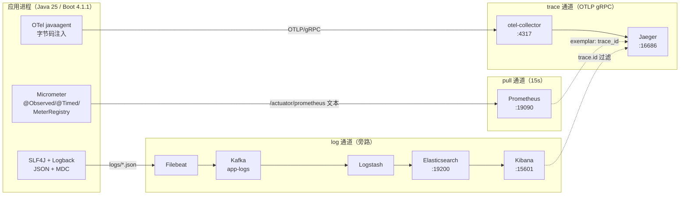
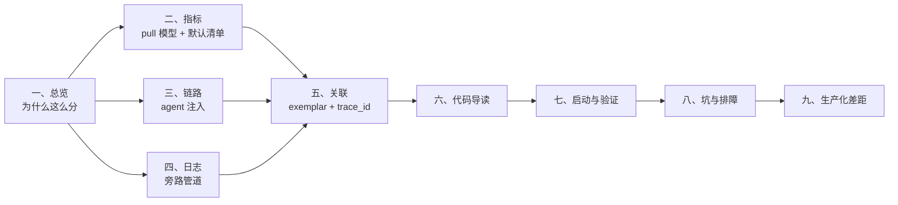

# hello-observability —— Spring Boot 4.1.1 观测体系落地样例

> 一个可跑的工程，把下面这套观测体系从"设计图"变成"能验证的事实"：
>
> **指标** Micrometer API + 注解 → Prometheus 文本端点 → 外界每 15s pull 一次
> **链路** opentelemetry-javaagent 自动注入 → OTLP gRPC → otel-collector → Jaeger
> **日志** SLF4J + Logback → JSON 文件 → Filebeat → Kafka → Logstash → Elasticsearch → Kibana

---

## 如何读这份文档

这份文档不是"快速上手"，而是**设计说明 + 实测记录**。建议按角色挑着读：

| 你想解决的问题 | 直接读 |
|---|---|
| 这套体系为什么这么分层，各组件边界在哪 | [一、总览](#一总览) |
| 指标怎么埋、怎么命名、怎么不被基数拖死 | [二、指标](#二指标micrometer--prometheus-pull-模型) |
| **默认就有哪些指标（JVM/Tomcat/连接池…），分别什么意思** | [2.6 默认指标清单](#26-默认指标清单一行埋点不写boot-给了你什么) |
| agent 到底改了什么，span 长什么样 | [三、链路](#三链路otel-agent--collector--jaeger) |
| 日志为什么绕一大圈，Kafka 在图里干什么 | [四、日志](#四日志logback--filebeat--kafka--logstash--es--kibana) |
| 三个面板怎么串起来排查一次故障 | [五、关联](#五三支柱关联从"指标报警"到"那一行日志") |
| 照着做，一条命令跑起来 | [七、启动与验证](#七启动与验证) |
| 已经踩过的坑 | [八、坑与排障](#八坑与排障实测) |
| 上生产还差什么 | [九、生产化差距清单](#九生产化差距清单) |

**约定**：本文所有"实测"字样，都是在 `D:\code\workspace\hello-observability` 里真实跑出来的输出，不是示意。

---

## 一、总览

### 1.1 一句话定位

> 用 **push 的链路 + pull 的指标 + 旁路的日志**，把一次请求的一生拆成三条互不阻塞的通道，
> 再用 **trace_id** 和 **exemplar** 两颗钉子把它们钉在一起。

### 1.2 设计哲学：三条通道，两种方向

三个支柱看着像"三套监控"，实际上是三种**不同的数据模型**，强行统一是灾难：

| | 指标 | 链路 | 日志 |
|---|---|---|---|
| 数据形态 | 数值时序（可聚合） | 有向调用树（有因果） | 离散事件（有全文） |
| 方向 | **pull**：外界来要 | **push**：应用要送 | **旁路**：谁也不打扰 |
| 采样 | 全量（聚合后很小） | 采样（1%–100%） | 全量但分级 |
| 回答的问题 | "整体有没有事" | "慢在哪一跳" | "到底发生了什么" |
| 代价 | 便宜 | 贵（存储/带宽） | 便宜但吵 |

由此推出本工程的三个关键技术决定（每一条都在后面章节展开）：

1. **指标用 pull，不用 OTLP push。** 应用只需暴露一个 `/actuator/prometheus`，谁想看谁来抓。
   pull 模型自带"目标存活探测"语义（抓不到就是挂了），也让采集频率成为**消费方的配置**而不是应用的负担。
2. **链路用 javaagent，不引 SDK。** 业务代码里没有一行 `TracerProvider` 初始化，
   HTTP/Tomcat/JDBC/Redis 这些框架级 span 全部由字节码注入产生；业务只补"值得补"的语义 span。
3. **日志不走 OTLP，走 Filebeat 旁路。** 日志量大、格式杂、要全文检索，
   用 ES 生态最省事；而且**即使链路后端全挂，日志文件照样落盘**——这是排障的下限保障。

**两种方向并存的关键**：`OTEL_METRICS_EXPORTER=none`、`OTEL_LOGS_EXPORTER=none` 把 agent 的指标/日志出口
彻底关掉，保证"一份数据只有一个来源、一个口径"。这是最容易忽略、也最容易出事的一行配置。

### 1.3 全景图



ASCII 版（不方便渲染 mermaid 时）：

```
                ┌──────────────────────── 应用进程 ────────────────────────┐
   HTTP 请求 ──► │ Tomcat ─► Controller ─► Service ─► 手工 span/指标/日志    │
                │   ▲           ▲            ▲                            │
                │   │ agent 注入 │ @Observed  │ @WithSpan                  │
                └───┼───────────┼────────────┼────────────────────────────┘
                    │           │            │
        ┌───────────┘           │            └──────────────┐
        ▼                       ▼                           ▼
  otel-collector:4317    /actuator/prometheus          logs/*.json
        │                       ▲                           │
        ▼                       │ 每 15s pull               ▼
     Jaeger:16686          Prometheus:19090             Filebeat
        ▲                       │                           │
        └─── exemplar ──────────┘                           ▼
        └─── Kibana 里点 trace.id ────────────────►  Kafka ─► Logstash ─► ES ─► Kibana
```

### 1.4 责任边界表

| 组件 | 只做一件事 | 明确不做 | 挂了会怎样 |
|---|---|---|---|
| Micrometer | 把观测值转成 Meter | 不负责推送、不负责存储 | 指标缺，业务正常 |
| Prometheus | 定时抓取 + 短期存储 + 查询 | 不做日志、不做链路 | 指标断档，业务正常 |
| OTel agent | 自动注入 span + 传播上下文 + 导出 | 不碰指标、不碰日志（本工程已关） | 链路缺失，业务正常 |
| otel-collector | 统一接收/处理/转发遥测数据 | 不是存储，重启即丢队列 | 链路断，业务正常 |
| Jaeger | 链路存储 + 检索 UI | 不做指标聚合 | 链路查不了 |
| Filebeat | 采集 + 搬运日志 | 不做解析富化（留给 Logstash） | 日志进不了 Kafka，但文件还在磁盘 |
| Kafka | 日志缓冲/削峰/多消费 | 不是存储终点 | Logstash 消费暂停，Kafka 里积压 |
| Logstash | 解析 + 富化 + 转储 | 不做采集 | 日志进不了 ES，Kafka 里积压 |
| Elasticsearch | 全文索引 + 聚合 | 不做采集 | 日志查不了 |
| Kibana | 可视化 + 检索 | 不存数据 | 面板打不开 |

**这张表的价值**：任何一个组件挂掉，都只损失**一个支柱的一部分**，业务和另外两个支柱不受影响。
这就是"三条通道互不阻塞"的实际含义，也是这套架构最该被验证的性质。

### 1.5 版本矩阵（实测可解析）

| 组件 | 版本 | 说明 |
|---|---|---|
| JDK | 25.0.1 LTS | Boot 4 基线 Java 17，生产推荐 21/25 |
| Spring Boot | 4.1.1 | parent 固定版本 |
| Tomcat | 11.0.24 | Boot 4 自带 |
| Micrometer | 1.17.1 | 由 Boot BOM 管理 |
| Logback | 1.5.38 | 由 Boot BOM 管理 |
| logstash-logback-encoder | 8.1 | JSON 编码 |
| opentelemetry-javaagent | 2.33.1 | 独立进程外挂，与 pom 无关 |
| opentelemetry-api | 1.67.0 | 仅编译期；运行时被 agent 接管 |
| Prometheus Java client | 1.7.0 | micrometer-registry-prometheus 传递依赖 |
| Prometheus Server | v3.0.1 | 容器镜像 |
| otel-collector-contrib | 0.115.0 | 容器镜像 |
| Jaeger | 2.1.0 | v2，原生收 OTLP |
| Kafka | 4.0.0 | KRaft 单节点 |
| Elasticsearch / Logstash / Kibana / Filebeat | 8.15.3 | 四件套版本必须一致 |

> 镜像 tag 全部写死语义版本，不用 `latest`。升级时四件套一起动（ES 的 index 兼容性由 minor 保证）。

### 1.6 端口与目录

| 端口 | 服务 | 说明 |
|---|---|---|
| 8080 | 应用 | `/actuator/prometheus` 是 pull 入口 |
| 4317 / 4318 | otel-collector | OTLP gRPC / HTTP |
| 16686 | Jaeger UI | |
| 19090 | Prometheus | 刻意避开 9090 |
| 19200 | Elasticsearch | |
| 15601 | Kibana | |
| 19092 | Kafka（宿主侧） | 避开 study-stack 的 9092 |
| 19600 | Logstash 监控 API | |

```
D:\code\workspace\
├── hello-observability\            ← 应用工程（本仓库主体）
│   ├── src\main\java\com\example\obs\
│   │   ├── config\TelemetryConfig.java           @Observed 切面 + OTel Tracer 装配
│   │   ├── config\PrometheusExemplarConfig.java  exemplar：指标→trace 的桥
│   │   ├── metrics\BusinessMetrics.java          业务指标（Counter/Gauge/Summary）
│   │   ├── service\OrderService.java             @Observed + @WithSpan + 手工 span
│   │   ├── service\RiskService.java              @WithSpan + @Timed 共存
│   │   ├── web\GlobalExceptionHandler.java       异常 → 三支柱
│   │   └── log\Traces.java                       traceId 回吐到响应
│   ├── src\main\resources\
│   │   ├── application.yml                       指标配置（直方图/SLO/公共标签）
│   │   └── logback-spring.xml                    JSON 落地 + MDC
│   ├── otel-agent\opentelemetry-javaagent.jar    由脚本下载，不入库
│   ├── scripts\{fetch-otel-agent,run-local,demo-traffic}.sh
│   ├── postman\hello-observability.postman_collection.json
│   └── Dockerfile                                多阶段 + agent
└── docker-stacks\obs-stack\        ← 后端全家桶
    ├── compose.yaml
    ├── otel-collector\config.yaml
    ├── prometheus\prometheus.yml
    ├── filebeat\filebeat.yml
    └── logstash\pipeline\app-logs.conf
```

### 1.7 章节地图



---

## 二、指标：Micrometer + Prometheus pull 模型

### 2.1 为什么是 pull，以及"15 秒"意味着什么

push 模型下，采集频率是**应用**的责任（每 15s 自己发一次）；pull 模型下，它是**消费方**的责任：

```yaml
# docker-stacks/obs-stack/prometheus/prometheus.yml
global:
  scrape_interval: 15s      # ← 需求里的"外界每 15s 调用一次"就是这一行
  scrape_timeout: 10s       # ← 必须小于 scrape_interval
```

这 15s 决定了三件事，写代码时必须心里有数：

1. **指标的"分辨率"就是 15s。** 一次持续 3 秒的尖峰，很可能落在两个抓取点之间被平均掉。
   `rate(x[5m])` 这类查询在 Prometheus 里至少需要 4 个样本才有意义，即 1 分钟粒度起。
2. **应用侧不能有"每次抓取都算一遍"的重活。** Meter 是常驻内存的累加器，抓取只是把当前值序列化。
   本工程 `BusinessMetrics` 的所有 Meter 都在构造期注册，请求路径上只 `increment()`/`record()`。
3. **抓取超时 = 这一次样本丢失。** 如果 `/actuator/prometheus` 因为某个 Meter 的 `Gauge` 回调里做了 RPC 而变慢，
   丢的不是"这一秒"，而是整个 15s 窗口。**Gauge 的取值函数必须是无阻塞的本地读取。**

pull 的代价：应用必须**可被采集方访问**。容器里跑的应用，Prometheus 要么用 `host.docker.internal`，
要么和应用同网络（compose 的 `app` profile 就是这样接的，见 `prometheus.yml` 里的注释切换）。

### 2.2 三种埋点方式，各管一段

| 方式 | 写法 | 产出指标 | 落点 |
|---|---|---|---|
| **框架自带** | 什么都不用做 | `http_server_requests_seconds_*`、`jvm_*`、`system_*`、`tomcat_*` | Boot Actuator 自动配置 |
| **注解** | `@Observed` / `@Timed` / `@Counted` | `order_place_seconds_*`、`risk_check_seconds_*` | 切面织入（需要 `ObservedAspect`） |
| **编程式** | `MeterRegistry.counter(...)` | `order_placed_total`、`order_amount_CNY_*`、`order_inflight` | 业务代码显式打点 |

#### 注解埋点的两个必踩坑

**(1) `@Observed` 默认不生效。** Boot 只有在 `management.observations.annotations.enabled=true`
时才自动装配 `ObservedAspect`，默认是关闭的。本工程选择显式声明（更直观，也不依赖属性开关）：

```java
// config/TelemetryConfig.java
@Bean
public ObservedAspect observedAspect(ObservationRegistry registry) {
    return new ObservedAspect(registry);   // 没有这个 bean，@Observed 会被静默忽略
}
```

**(2) 注解埋点需要 AspectJ 在 classpath。** Boot 4 把 `spring-boot-starter-aop`
**改名成了 `spring-boot-starter-aspectj`**，写老名字会直接报 `version is missing`（BOM 里没有它了）。

#### `@Timed` 的百分位配置

```java
@Timed(value = "order.query", percentiles = {0.5, 0.95, 0.99}, histogram = true)
```

- `percentiles` 让 Micrometer **在客户端**算分位（`order_query_seconds{quantile="0.95"}`）。
  优点：查询零成本；缺点：**分位数不可跨实例聚合**（这不是 bug，是数学性质）。
- `histogram = true` 额外吐出 `_bucket`，让 Prometheus 用 `histogram_quantile()` **服务端**算分位，可跨实例聚合。
  生产上应该只留 histogram，客户端分位主要用于"单实例快速看"。

### 2.3 命名与标签：基数（cardinality）是唯一的敌人

一条时间序列 = 指标名 + 一组标签值。**标签值的组合数就是序列数**，
每个序列都要占内存、占存储、占抓取带宽。这就是为什么：

```java
// 反面教材：把 URL / 用户 ID / 订单号当标签
registry.counter("order.placed", "orderId", orderId);   // 序列数 = 订单数 → 直接把 Prometheus 打挂

// 正确做法：标签只用"有限枚举"
registry.counter("order.failed.by.reason", "reason", reason);   // reason ∈ {risk_rejected, out_of_stock, internal_error}
```

本工程的命名遵循 Micrometer 官方推荐的 `领域.对象.单位`：

| 指标名（Micrometer） | 暴露名（Prometheus） | 类型 | 标签 |
|---|---|---|---|
| `order.placed` | `order_placed_total` | Counter | `channel` |
| `order.failed` | `order_failed_total` | Counter | `channel` |
| `order.failed.by.reason` | `order_failed_by_reason_total` | Counter | `reason` |
| `order.amount` | `order_amount_CNY` | DistributionSummary | — |
| `order.inflight` | `order_inflight` | Gauge | — |
| `order.place`（@Observed） | `order_place_seconds` | Timer | `class`/`method`/`error` |
| `order.query`（@Timed） | `order_query_seconds` | Timer | `class`/`method`/`exception` |
| `http.server.requests`（框架） | `http_server_requests_seconds` | Timer | `uri`/`method`/`status`/`outcome`/`exception`/`error` |

> **`instance` 标签的坑**：不要在 `management.metrics.tags` 里定义 `instance`。
> Prometheus 抓取时会用 target 自动生成 `instance`，撞名后你定义的那个会被改名成 `exported_instance`，
> 查询和 Grafana 变量全乱。应用侧只打 `application` / `env`，`instance` 交给采集侧。

### 2.4 直方图与 SLO：把桶配在业务关心的边界上

```yaml
management:
  metrics:
    distribution:
      percentiles-histogram:
        "[http.server.requests]": true
        "[order.place]": true
      slo:
        "[http.server.requests]": 50ms,100ms,200ms,500ms,1s,2s,5s
        "[order.place]": 100ms,300ms,1s
      minimum-expected-value:
        "[http.server.requests]": 5ms
      maximum-expected-value:
        "[http.server.requests]": 10s
```

三个要点：

1. **默认桶不能用**。Micrometer 的默认桶（`1ms,2ms,3ms…` 一路线性）在 HTTP 场景下完全跑偏；
   要么给 SLO 定桶，要么设 `min/max-expected-value` 让它按指数生成。
2. **桶的数量就是序列数**。`_bucket` 每个桶一条序列，20 个桶 × 30 条 URI = 600 条序列，只是这一条指标。
3. **DistributionSummary 别乱开 `publishPercentileHistogram()`**。本工程第一版对 `order.amount` 开了它，
   结果吐出了 `le="1.0", le="2.0", … le="12.0"` 一堆没用的桶（金额是几十到几千），
   改成只给 `serviceLevelObjectives(50,100,500,1000,5000)` 后干净利落：

```
order_amount_CNY_bucket{le="50.0"} 0
order_amount_CNY_bucket{le="100.0"} 1
order_amount_CNY_bucket{le="500.0"} 1
order_amount_CNY_bucket{le="1000.0"} 1
order_amount_CNY_bucket{le="5000.0"} 1
order_amount_CNY_count 1
order_amount_CNY_sum 117.0
```

4. **三者是并集，不是覆盖**（写 §2.6 时实测更正）。上面那份 HTTP 配置同时开了 `percentiles-histogram`、`slo`
   和 `min/max-expected-value`，Micrometer 输出的不是 7 个 SLO 桶，而是
   **"指数桶 ∪ SLO 桶" = 每个序列 58 个桶**（`http_server_requests_seconds_bucket` 实测 116 条 = 58 × 2 个组合）。
   只想要 SLO 边界就别开 `percentiles-histogram`——`order.amount` 正是这么做的，只有 5 个桶。
   > 换句话说：`percentiles-histogram: true` 是"我要精确 P99"的承诺，代价是 40+ 个额外桶；两者不能既要又要。

### 2.5 端到端验证（实测输出）

```bash
# ① 抓一次，看业务指标
curl -s localhost:8080/actuator/prometheus | grep '^order_'

order_placed_total{application="hello-observability",channel="http",env="local"} 1.0
order_amount_CNY_bucket{application="hello-observability",env="local",le="500.0"} 1.0
order_place_seconds_count{application="hello-observability",class="com.example.obs.service.OrderService",env="local",error="none",method="place"} 1.0
http_server_requests_seconds_count{...status="201",uri="/api/orders"} 1.0
```

```bash
# ② 要 OpenMetrics 格式才有 exemplar（里面带 trace_id）
curl -s -H 'Accept: application/openmetrics-text;version=1.0.0' \
     localhost:8080/actuator/prometheus | grep trace_id

order_place_seconds_bucket{...le="0.223696211"} 1 # {span_id="239ecb3209464949",trace_id="22832d148b551c866e6a329a4c58a9a6"} 0.2182753 1793628804.843
```

这个 `trace_id` 就是**指标与链路之间唯一的自动化连接点**（原理见 [5.2](#52-exemplar把指标异常钉到具体请求)）。

### 2.6 默认指标清单：一行埋点不写，Boot 给了你什么

先把结论摆出来。本工程（Boot 4.1.1 / Micrometer 1.17.1 / JDK 25 / 虚拟线程开启）启动、打了几笔流量后抓一次：

```bash
curl -s localhost:8080/actuator/prometheus | grep -vc '^#'        # 603  → 序列数
curl -s localhost:8080/actuator/prometheus | grep -c  '^# TYPE'   # 76   → 指标族数
```

603 条序列里，**业务代码产生的只有 8 个族**（`order_*` / `risk_check_*` / `quote_calc_*`），
剩下 68 个全是框架白送的：JVM、进程、HTTP、Tomcat、Logback、启动耗时。
这也说明一件事：可观测性里最值钱的那部分（JVM / GC / 连接池）**不需要写业务代码**，
难的是知道它们叫什么、什么时候会"看起来有其实没有"（见 [2.6.9](#269-五个以为有其实没有的指标实测)）。

读表约定：

- 名字一栏是 **Prometheus 侧**的名字（Micrometer 侧是点号：`jvm.memory.used` ↔ `jvm_memory_used_bytes`）；
  `/actuator/metrics` 端点里查要用点号，这个差异后面 §2.6.11 还会踩一次。
- 类型：Gauge=瞬时值、Counter=只增、Timer=耗时分布（`_count/_sum/_max/_bucket`）、LongTaskTimer=正在进行中的任务。
- 全局标签 `application` / `env` 每张表都不重复列。

#### 2.6.1 JVM 内存与 GC（`jvm.*`）

| 指标 | 类型 | 关键标签 | 含义 / 怎么用 |
|---|---|---|---|
| `jvm_memory_used_bytes` | Gauge | `area`=`heap`/`nonheap`、`id`=池名 | 各内存池当前已用。**不要只盯 used**，GC 后不降才是泄漏 |
| `jvm_memory_committed_bytes` | Gauge | 同上 | 已向 OS 要到（提交）的内存量，介于 used 与 max 之间 |
| `jvm_memory_max_bytes` | Gauge | 同上 | 池上限。**实测 `G1 Eden Space`/`G1 Survivor Space`/`Metaspace` 为 `-1`**（无上限），算使用率必须 `> 0` 过滤，否则除出负数 |
| `jvm_gc_max_data_size_bytes` | Gauge | — | 老年代上限（≈ Xmx 减 survivor），**算堆压力用这个比 `jvm_memory_max_bytes` 可靠** |
| `jvm_gc_live_data_size_bytes` | Gauge | — | 上次 GC 后老年代存活对象大小，真正的"必需内存" |
| `jvm_memory_usage_after_gc` | Gauge | — | 老年代使用率 0~1（GC 后），比 used/max 稳 |
| `jvm_gc_overhead` | Gauge | — | 最近一段窗口内 GC 占用比例 0~1，**>0.1 就该查**（正常服务 <0.02） |
| `jvm_gc_memory_allocated_bytes_total` | Counter | — | 年轻代分配总量，`rate()` 后是分配速率，突增=流量或大对象 |
| `jvm_gc_memory_promoted_bytes_total` | Counter | — | 晋升到老年代的总量，`rate()` 长期偏高=对象活得太久 |
| `jvm_gc_pause_seconds` | Timer | `cause`、`action` | 每次 GC 的停顿。**实测：没发生过 GC 时它根本不存在**（见 2.6.9） |
| `jvm_gc_concurrent_phase_time_seconds` | Timer | `cause`、`action` | 并发阶段（G1 concurrent mark 等）耗时，只在发生后才出现 |

本机实测的池名（`id`）共 8 个，做面板时按 `area` 分组即可：

```
heap    : G1 Eden Space / G1 Survivor Space / G1 Old Gen
nonheap : Metaspace / Compressed Class Space / CodeHeap 'non-nmethods' / CodeHeap 'profiled nmethods' / CodeHeap 'non-profiled nmethods'
```

#### 2.6.2 JVM 线程、类、缓冲、编译

| 指标 | 类型 | 关键标签 | 含义 / 怎么用 |
|---|---|---|---|
| `jvm_threads_live_threads` | Gauge | — | 当前存活线程数（含守护）。**泄漏的第一信号**，按 1h 环比看趋势 |
| `jvm_threads_daemon_threads` | Gauge | — | 守护线程数 |
| `jvm_threads_peak_threads` | Gauge | — | 历史峰值（只增不减） |
| `jvm_threads_started_threads_total` | Counter | — | 累计创建线程数，只增；`rate()` 高说明线程在频繁创建销毁（线程池没复用） |
| `jvm_threads_states_threads` | Gauge | `state`=`runnable`/`blocked`/`waiting`/`timed-waiting`/`new`/`terminated` | 各状态线程数。`blocked` 持续高=锁竞争；`waiting` 高通常正常（等 IO/池） |
| `jvm_classes_loaded_classes` | Gauge | — | 当前已加载类数 |
| `jvm_classes_unloaded_classes_total` | Counter | — | 累计卸载类数，`rate()` 高说明在不停生成类（动态代理/CGLIB 失控） |
| `jvm_classes_loaded_count_classes_total` | Counter | — | 累计加载类数。名字很怪：Micrometer 用**同一个前缀** `jvm.classes.loaded` 注册"当前加载数"（gauge）和"累计加载数"（counter），Prometheus 侧被拼成 `_count_classes_total`。**看现状用 `..._loaded_classes`，看 `rate()` 用这个** |
| `jvm_compilation_time_ms_total` | Counter | — | JIT 编译累计耗时 |
| `jvm_buffer_count_buffers` | Gauge | `id`=`direct`/`mapped`/`mapped - 'non-volatile memory'` | **DirectByteBuffer 数量**，Netty/NIO 项目必看 |
| `jvm_buffer_memory_used_bytes` | Gauge | 同上 | 直接内存已用（不占堆，OOM: Direct buffer memory 的元凶） |
| `jvm_buffer_total_capacity_bytes` | Gauge | 同上 | 直接内存总容量 |
| `jvm_info` | Gauge（恒为 1） | `version`、`vendor`、`runtime` | 值无意义，**标签有意义**：面板上 `count by (version)` 就能看到实例的 JDK 版本 |

#### 2.6.3 进程与宿主

| 指标 | 类型 | 标签 | 含义 / 坑 |
|---|---|---|---|
| `process_cpu_usage` | Gauge | — | 进程近期 CPU 使用率 0~1。**JDK 已按核数归一，`1.0` = 把 JVM 能用的所有核跑满**，不是"一个核的百分之百"。容器里 JVM 看到的核数常与 cgroup limit 不一致，会失真 |
| `process_cpu_time_ns_total` | Counter | — | 进程累计 CPU 时间（ns），`rate()` 得每秒 CPU 秒 |
| `process_uptime_seconds` | Gauge | — | 运行时长，**突然变小=重启**（比日志更早发现） |
| `process_start_time_seconds` | Gauge | — | 启动时间戳，做多实例"谁重启了" |
| `system_cpu_usage` | Gauge | — | 整机 CPU 使用率。**容器里读到的是宿主机，不是 cgroup 限额**，容器环境慎用 |
| `system_cpu_count` | Gauge | — | JVM 看到的可用核数，解释并发度/默认线程池大小 |
| `disk_free_bytes` / `disk_total_bytes` | Gauge | `path` | 工作目录所在盘的可用/总空间。**只管一个目录**，日志把盘写满时它是唯一提前告警 |

#### 2.6.4 HTTP 服务端（`http.server.requests`）

| 指标 | 类型 | 含义 |
|---|---|---|
| `http_server_requests_seconds_count` | Counter | 请求数，标签组合决定维度 |
| `http_server_requests_seconds_sum` | Counter | 总耗时，可算平均值（但别用平均值做 SLO） |
| `http_server_requests_seconds_max` | Gauge | 窗口内最大耗时 |
| `http_server_requests_seconds_bucket` | Histogram | 分桶，算 P95/P99 的唯一依据 |
| `http_server_requests_active_seconds_*` | LongTaskTimer | **正在处理中**的请求：`_gcount`=在途请求数、`_gsum`=它们已耗费的总时长、`_max`=最久的那一个 |

标签：`method`、`uri`（**路由模板**，如 `/api/orders/{orderId}`，不是原始路径）、`status`、`outcome`（`SUCCESS`/`CLIENT_ERROR`/`SERVER_ERROR`）、`exception`、`error`。

三个必须知道的点：

1. `uri` 是模板，所以基数可控；但 `status`+`exception` 组合会放大序列数——**不要给 `uri` 打业务参数**。
2. 404 也会计入（`outcome="CLIENT_ERROR"`），扫接口时会被当成"有流量"。
3. `http_server_requests_active_seconds` 是 Boot 4 新面孔，**它的 `uri` 标签实测全是 `UNKNOWN`**（请求开始时还没匹配到路由），
   所以只能看总量：`sum(http_server_requests_active_seconds_gcount)`。而且它按 58 个桶展开，只为看一个并发数付这个代价不值：
   ```yaml
   management.metrics.enable:
     "[http.server.requests.active]": false   # 不要这个族
   ```

#### 2.6.5 Tomcat：默认只给 6 条，开了 MBean 才给全

**默认配置**（`server.tomcat.mbeanregistry.enabled=false`）下只有 Session 这 6 条，因为它们从 `Manager` 直接读，不走 JMX：

| 指标 | 含义 |
|---|---|
| `tomcat_sessions_active_current_sessions` | 当前活跃会话数 |
| `tomcat_sessions_active_max_sessions` | 历史最大并发会话数 |
| `tomcat_sessions_created_sessions_total` | 累计创建会话数 |
| `tomcat_sessions_expired_sessions_total` | 累计过期会话数（与 created 的比值≈会话回收情况） |
| `tomcat_sessions_rejected_sessions_total` | 因超上限被拒的会话数，**>0 就是事故** |
| `tomcat_sessions_alive_max_seconds` | 会话最长存活时间 |

加上 `server.tomcat.mbeanregistry.enabled=true` 后，实测多出 **16 个族**（下表），值都来自 Tomcat 的 JMX：

| 指标 | 标签 | 含义 |
|---|---|---|
| `tomcat_threads_current_threads` | `name`=连接器名 | 当前线程数 |
| `tomcat_threads_busy_threads` | 同上 | 正在干活的线程数，**≈ 线程池饱和度** |
| `tomcat_threads_config_max_threads` | 同上 | 配置的最大线程数（`server.tomcat.threads.max`） |
| `tomcat_connections_current_connections` | 同上 | 当前连接数 |
| `tomcat_connections_config_max_connections` | 同上 | 最大连接数（默认 8192） |
| `tomcat_connections_keepalive_current_connections` | 同上 | keep-alive 长连接数（**大量 keep-alive 会占满连接数**） |
| `tomcat_global_request_seconds_*` | 同上 | 容器收到的全部请求耗时（含静态资源、无 URI 维度） |
| `tomcat_global_request_max_seconds` | 同上 | 容器级最大请求耗时 |
| `tomcat_global_error_total` | 同上 | 容器级错误数 |
| `tomcat_global_received_bytes_total` / `tomcat_global_sent_bytes_total` | 同上 | 收发字节数，做流量/带宽面板 |
| `tomcat_servlet_request_seconds_*` / `_max_seconds` | `name`=servlet 名 | 按 servlet 拆分（本工程只有 `dispatcherServlet`） |
| `tomcat_servlet_error_total` | 同上 | 按 servlet 的错误数 |
| `tomcat_cache_access_total` / `tomcat_cache_hit_total` | — | 静态资源缓存（`WebResourceRoot`）的访问/命中次数，命中率 = hit/access |

**⚠️ 本工程开虚拟线程，`tomcat_threads_*` 实测全是 `-1`：**

```text
tomcat_threads_busy_threads{name="http-nio-8080"}   -1.0
tomcat_threads_current_threads{name="http-nio-8080"} -1.0
tomcat_threads_config_max_threads{name="http-nio-8080"} -1.0
```

因为 `spring.threads.virtual.enabled=true` 后 Tomcat 用 `VirtualThreadExecutor`，没有 `ThreadPoolExecutor` 可读。
**-1 的意思是"这个指标对当前配置没有意义"，不是"0 个线程"**。要么关掉虚拟线程，要么别拿它配线程池告警。

最后一条纪律：`tomcat_global_*` 和 `http_server_requests_*` 统计的是同一批请求的两个视角。
**面板和告警只认后者**（有 uri/status/outcome 维度），前者只用来"交叉校验容器侧总量对不对"。

#### 2.6.6 数据库连接池：HikariCP 会给你两套

前提：只要 classpath 上有 `micrometer-core`，Boot 4 的 `HikariDataSourceMeterBinder` 会自动给
`HikariDataSource` 装上 `MicrometerMetricsTrackerFactory`（反编译确认：已有 registry/tracker 时跳过）。
**不需要 `register-mbeans=true`，也不需要自己写代码**。下表是 HikariCP 7.0.2 + H2 实测（`max=10, min=2`，跑了 5 次查询）：

```text
hikaricp_connections{pool="probe-pool"}                       2.0    # 总连接（active+idle）
hikaricp_connections_active{pool="probe-pool"}                0.0
hikaricp_connections_idle{pool="probe-pool"}                  2.0
hikaricp_connections_pending{pool="probe-pool"}               0.0    # 排队等连接的线程
hikaricp_connections_max{pool="probe-pool"}                   10.0
hikaricp_connections_min{pool="probe-pool"}                   2.0
hikaricp_connections_acquire_seconds_count{pool="probe-pool"} 5
hikaricp_connections_acquire_seconds_sum{pool="probe-pool"}   6.04E-5
hikaricp_connections_acquire_seconds_max{pool="probe-pool"}   2.46E-5
hikaricp_connections_creation_seconds_count{pool="probe-pool"} 1
hikaricp_connections_usage_seconds_count{pool="probe-pool"}   5
hikaricp_connections_usage_seconds_sum{pool="probe-pool"}     0.02
hikaricp_connections_timeout_total{pool="probe-pool"}         0.0
```

| 指标 | 类型 | 含义 / 怎么用 |
|---|---|---|
| `hikaricp_connections` | Gauge | 池中连接总数（active + idle），应稳定在 `min`~`max` 之间 |
| `hikaricp_connections_active` | Gauge | 借出中的连接。**持续等于 max 就是打满了** |
| `hikaricp_connections_idle` | Gauge | 空闲连接，长期被压到 0 说明并发高于池容量 |
| `hikaricp_connections_pending` | Gauge | **等连接的线程数**，`>0` 持续 1 分钟 = 池太小或 SQL 太慢，这是最灵敏的一个 |
| `hikaricp_connections_max` / `_min` | Gauge | 配置值（`maximumPoolSize` / `minimumIdle`），做对比基线 |
| `hikaricp_connections_acquire_seconds` | Timer | **从调用 `getConnection()` 到拿到连接的等待时间**。P99 抬头=池饥饿，比 pending 更早预警 |
| `hikaricp_connections_creation_seconds` | Timer | 物理建连（TCP+认证）耗时。突增=网络/数据库端在抖 |
| `hikaricp_connections_usage_seconds` | Timer | 连接被业务占用的时长 ≈ SQL 执行时长，**定位慢 SQL 的第一现场** |
| `hikaricp_connections_timeout_total` | Counter | 等待连接超时次数，**任何非零增长都是故障**（业务侧会看到 `SQLTransientConnectionException`） |

Boot 另外还给一套**跨池类型统一**的抽象（Hikari/Tomcat/DBCP2/UCP 通用）：

| 指标 | 标签 | 说明 |
|---|---|---|
| `jdbc_connections_max` / `jdbc_connections_min` | `name`="dataSource" | 配置上下限，**任何情况下都有** |
| `jdbc_connections_active` / `jdbc_connections_idle` | 同上 | 实测**只有"启动期已经建过连接"时才注册** |

第二行那个"实测"值得展开，因为它是个静默坑：Boot 的 binder 在**启动时**取一次值，取到 `null` 就跳过注册；
而 Hikari 的池是懒建的（第一次 `getConnection()` 才创建），所以：

| 场景 | `jdbc_connections_active/idle` | `hikaricp_*` |
|---|---|---|
| 纯懒加载（没有任何启动期 SQL） | **缺失** | 齐全（第一次用池时才注册） |
| 启动期建过连接（Flyway / JPA 校验 / `schema.sql` / 预热） | 齐全 | 齐全 |

结论：**Hikari 项目只认 `hikaricp_*`**，`jdbc_*` 当成"以后换成别的池也能用的兜底"。
两套并存时不要混着配告警，同一个含义两条曲线，阈值会互相打架。

#### 2.6.7 日志：`logback_events_total`

| 指标 | 类型 | 标签 | 含义 |
|---|---|---|---|
| `logback_events_total` | Counter | `level`=`trace`/`debug`/`info`/`warn`/`error` | 每个**通过级别过滤**的日志事件计一次 |

用法与坑：

- `rate(logback_events_total{level="error"}[5m])` 是**最便宜的异常率指标**，比从 ES 里聚合快得多（ES 挂了它还在）。
- 它统计的是"日志条数"，不是"异常个数"：一个异常打了 30 行栈，`error` 只 +1（栈是同一个 event），
  但如果 30 个线程各打一次就是 +30 —— 所以它天然能反映"日志风暴"。
- 级别被 `logging.level` 关掉的日志不会计数，**改日志级别会让曲线出现台阶**，看板要标注。

#### 2.6.8 启动耗时

| 指标 | 类型 | 含义 |
|---|---|---|
| `application_started_time_seconds` | Timer（`count` 恒为 1） | 从 `main` 到"上下文刷新完成"的耗时 |
| `application_ready_time_seconds` | Timer（`count` 恒为 1） | 到"可以对外服务"（`ApplicationReadyEvent`）的耗时 |

`max` 就是本次启动耗时。它俩的价值在于**回归**：某次发版启动从 8s 变 40s，日志里看不出来，这两条曲线一眼就看出来。

#### 2.6.9 五个"以为有、其实没有"的指标（实测）

这一节是本工程真正踩出来的，榜单按坑的隐蔽程度排序：

| # | 现象 | 原因 | 怎么办 |
|---|---|---|---|
| 1 | `@Timed` 的方法查不到 `xxx_seconds` | 只声明了 `ObservedAspect`，没声明 `TimedAspect`；而 `management.observations.annotations.enabled=false` 把 Boot 自动装配的 `TimedAspect`/`CountedAspect` 一起关了 | 显式声明两个切面（本工程已修，见 §8.2） |
| 2 | `jvm_gc_pause_seconds` 不存在 | 它是 GC 通知回调里才创建的 Timer，JVM 还没 GC 过就没有 | 别用它做"GC 是否发生"的探针；用 `jvm_gc_memory_allocated_bytes_total` 的 `rate()` |
| 3 | `tomcat_threads_*` 全是 `-1` | 开了虚拟线程，没有线程池 MXBean | 关虚拟线程，或去掉线程池告警 |
| 4 | `jdbc_connections_active/idle` 缺失 | 懒建池，binder 启动时取到 null 就跳过注册 | 用 `hikaricp_connections_*` |
| 5 | `http_server_requests_active_seconds` 的 `uri` 全是 `UNKNOWN` | 该 LongTaskTimer 在路由匹配前就开始计时 | 只按总量用，或直接关掉 |

#### 2.6.10 最小告警集：76 个族里只需要盯 9 条

| 关注点 | PromQL | 建议阈值 |
|---|---|---|
| 堆压力 | `jvm_gc_live_data_size_bytes / jvm_gc_max_data_size_bytes` | >0.85 持续 15m（**用 GC 后存活量，不是 used**） |
| GC 开销 | `jvm_gc_overhead` | >0.10 持续 10m |
| 线程泄漏 | `jvm_threads_live_threads` | 1h 环比 +50% 或绝对值 > 800 |
| 请求 P99 | `histogram_quantile(0.99, sum by (le) (rate(http_server_requests_seconds_bucket[5m])))` | 按接口定 SLO |
| 5xx 比例 | `sum(rate(http_server_requests_seconds_count{status=~"5.."}[5m])) / sum(rate(http_server_requests_seconds_count[5m]))` | >1% 持续 5m |
| 连接池饥饿 | `hikaricp_connections_pending` / `rate(hikaricp_connections_timeout_total[5m])` | pending>0 持续 1m；timeout 增速>0 |
| 取连接变慢 | `histogram_quantile(0.99, sum by (le) (rate(hikaricp_connections_acquire_seconds_bucket[5m])))` | >10ms |
| 错误日志 | `sum(rate(logback_events_total{level="error"}[5m]))` | >0.1/s |
| 重启 | `changes(process_start_time_seconds[10m])` | >0 |

注意第 1 条：**堆使用率必须用 `jvm_gc_live_data_size_bytes / jvm_gc_max_data_size_bytes`**。
直接拿 `jvm_memory_used_bytes{area="heap"} / jvm_memory_max_bytes{area="heap"}` 会把 `-1` 的无上限池算进去，
得到负数或无穷大——这是新手面板最常见的错。

#### 2.6.11 自查：确认"我这个项目到底有哪些指标"

```bash
# ① 指标族清单（用 Micrometer 的点号名，不是下划线！）
curl -s localhost:8080/actuator/metrics | jq -r '.names[]' | sort   # 没装 jq 就 `| tr ',' '\n'`

# ② 单个指标的标签与取值（点号名，查错名字会 404）
curl -s 'localhost:8080/actuator/metrics/jvm.memory.used' | jq '.availableTags, .measurements'

# ③ 序列数排行：谁在制造基数
curl -s localhost:8080/actuator/prometheus | grep -v '^#' | sed 's/{.*//' | sort | uniq -c | sort -rn | head
```

跑完 ③ 你会看到 603 条里的大头在哪：`http_server_requests_seconds_bucket`（58 桶 × 每个 method+uri+status 组合）、
`http_server_requests_active_seconds_bucket`（同样 58 桶，却只提供一个并发数）、以及各注解 Timer 的 58 桶。
**桶的数量就是序列数**，这也是 §2.4 那句"桶只配业务边界"的真正含义——顺带更正一下 §2.4 的说法：
`percentiles-histogram: true` + `slo` + `min/max-expected-value` **三者是取并集的**（实测每序列 58 个桶，不是 7 个）。
只想要 SLO 桶就别开 `percentiles-histogram`，照 `order.amount` 的写法只给 `serviceLevelObjectives`；
要精确 P99 就保留直方图，但别再把 `min/max-expected-value` 也配上。

> **本章小结**
> - 指标走 pull：采集频率是消费方的配置（15s），应用只负责把一个文本端点摆出来。
> - 埋点分三层：框架自带（不要重复造）、注解（要切面）、编程式（业务语义）；`@Observed` 必须配 `ObservedAspect`，`@Timed` 必须配 `TimedAspect`。
> - 一切设计围绕"基数"：标签只用有限枚举，桶只配业务边界。
> - 指标端点是**可以被抓挂的**：Gauge 取值函数不能有阻塞调用。
> - **默认指标已经覆盖了 JVM/GC/线程/HTTP/Tomcat/日志，占全部序列的 90% 以上**；写业务指标之前先看清楚框架给了什么（[2.6](#26-默认指标清单一行埋点不写boot-给了你什么)）。

---

## 三、链路：OTel Agent → Collector → Jaeger

### 3.1 为什么用 javaagent，而不是引 SDK

| | javaagent（本工程） | Spring Boot Starter + OTel SDK |
|---|---|---|
| 接入成本 | 加一个 `-javaagent` 参数 | 改 pom + 配置，通常还要引 `spring-boot-starter-opentelemetry` |
| 框架覆盖 | 100+ 库自动埋点（Tomcat/JDBC/Redis/Kafka/Netty…） | 只覆盖 Boot 集成的那几个 |
| 代码侵入 | 零 | 需要感知 SDK 初始化 |
| 可摘除性 | 去掉参数即恢复"裸奔" | 要去依赖、去配置 |
| 定制能力 | 弱于 SDK（但够用） | 强 |

**关键认知**：agent 不是"监控 SDK"，而是一个**运行时改写字节码的 JVM 插件**。
它在 `premain` 阶段用 ByteBuddy 把 `HttpServlet#service`、`SocketChannel#write` 这些方法包一层，
所以本工程里 `POST /api/orders` 那个 SERVER span，**业务代码一行都没写**：

```
'POST /api/orders' : 972674aa7324d0e0c689731e234b7d68 4c64a2e838dfaac4 SERVER
  [tracer: io.opentelemetry.tomcat-10.0:2.33.1-alpha]
  AttributesMap{data={http.response.status_code=201, http.route=/api/orders, http.request.method=POST,
    url.path=/api/orders, server.port=18080, user_agent.original=curl/8.21.0, ...}}
```

### 3.2 挂载方式：一个参数，两种写法

```bash
# 本机（scripts/run-local.sh）
java -javaagent:otel-agent/opentelemetry-javaagent.jar -jar app.jar
```

```dockerfile
# 容器（Dockerfile）——放在 JAVA_TOOL_OPTIONS 里，好处是"命令行零改动"
ENV JAVA_TOOL_OPTIONS="... -javaagent:/opt/otel/opentelemetry-javaagent.jar"
ENTRYPOINT ["java", "-jar", "application.jar"]
```

配置全部走环境变量（`OTEL_*`），因此**同一份镜像能通过环境变量切换环境**，不需要重新打包：

| 变量 | 值 | 作用 |
|---|---|---|
| `OTEL_SERVICE_NAME` | `hello-observability` | Jaeger 里的服务名 |
| `OTEL_RESOURCE_ATTRIBUTES` | `deployment.environment=local,service.version=0.0.1` | 资源属性，进每条 span |
| `OTEL_EXPORTER_OTLP_ENDPOINT` | `http://otel-collector:4317` | 出口 |
| `OTEL_EXPORTER_OTLP_PROTOCOL` | `grpc` | 需求指定的 gRPC |
| `OTEL_TRACES_EXPORTER` | `otlp` | 链路用 OTLP |
| `OTEL_METRICS_EXPORTER` | **`none`** | 指标不走 OTLP（走 Prometheus） |
| `OTEL_LOGS_EXPORTER` | **`none`** | 日志不走 OTLP（走 Filebeat） |
| `OTEL_INSTRUMENTATION_LOGBACK_APPENDER_ENABLED` | `false` | 禁止 agent 抓日志，否则一份日志两个通道 |
| `OTEL_INSTRUMENTATION_LOGBACK_MDC_ADD_BAGGAGE` | `true` | 把 baggage 也注入 MDC |
| `OTEL_TRACES_SAMPLER` | `parentbased_traceidratio` | 采样策略 |
| `OTEL_TRACES_SAMPLER_ARG` | `1.0` | demo 全采；生产 0.01~0.1 |

### 3.3 一条链路的真实结构

`POST /api/orders` 触发的 span 树（用 `OTEL_TRACES_EXPORTER=logging` 实测导出）：

```
POST /api/orders                      SERVER   [tomcat 自动注入]        ← 根，traceId 972674aa…
└── order.place                       INTERNAL [@WithSpan]             ← 业务语义 span
    ├── risk.check                    INTERNAL [@WithSpan]             ← 风控
    └── inventory.reserve             INTERNAL [手工 Tracer]            ← 带属性 + 事件
        └── quote.calc                INTERNAL [@WithSpan]             ← 询价
```

对应的导出片段（属性是真的）：

```
'risk.check'        AttributesMap{order.sku=A-100, order.qty=2, code.namespace=com.example.obs.service.RiskService}
'inventory.reserve' AttributesMap{inventory.sku=A-100, inventory.qty=2, inventory.warehouse=SH-01}
'order.place'       AttributesMap{order.sku=A-100, order.qty=2, order.qty=2}
```

#### 三种 span 的写法与适用场景

**(1) `@WithSpan`：一行代码换一个 span**

```java
@WithSpan("risk.check")
public Decision check(@SpanAttribute("order.sku") String sku, @SpanAttribute("order.qty") int qty) { ... }
```

`@SpanAttribute` 只对**方法参数**生效；span 名建议用 `领域.动作`，别用会爆基数的值（如订单号）。
agent 的 annotations 插桩会顺带加上 `code.namespace` / `code.function`，所以方法重命名后链路依然可读。

**(2) 手工 `Tracer.spanBuilder`：需要细粒度控制时**

```java
Span span = tracer.spanBuilder("inventory.reserve")
        .setAttribute(SKU, sku).setAttribute(QTY, qty).startSpan();
try (Scope ignored = span.makeCurrent()) {          // ← 关键：makeCurrent
    ...
    span.addEvent("inventory.reserved", Attributes.of(SKU, sku));
    return quoteService.quote(sku);
} catch (RuntimeException e) {
    span.recordException(e);
    span.setStatus(StatusCode.ERROR, "OUT_OF_STOCK");
    throw e;
} finally {
    span.end();                                     // ← 忘记 end() 就是内存泄漏 + 链路不完整
}
```

`makeCurrent()` 是整段代码的"上下文开关"：在这之后打的日志、发起的下游调用、调用的 `@WithSpan` 方法，
都会挂到这个 span 下。**没有 `makeCurrent` 的 span 是孤儿。**

**(3) 什么时候不需要 span**：每个 private 方法都加 `@WithSpan` 只会让链路变成噪音。
经验法则：**跨进程调用、跨组件边界、有明显耗时的业务步骤** 才值得一个 span。

### 3.4 跨线程：虚拟线程为什么必须 `Context.wrap`

OTel 的上下文是 **ThreadLocal** 的。新起的线程（包括虚拟线程）默认拿不到父上下文：

```java
// ❌ 子任务处于 root context → Jaeger 里变成 n 条孤立短链路
executor.submit(() -> quoteService.quote(sku));

// ✅ 把当前 Context 携带进去
executor.submit(Context.current().wrap(() -> quoteService.quote(sku)));
```

实测：`GET /api/demo/fanout?n=3` 的三个 `quote.calc` span，traceId 全部是 `ea849f2c7cc11f2f3d756537f99a4c6b`，
并且挂在同一个 `GET /api/demo/fanout` server span 下。顺带一个细节：

```
'quote.calc' : ea849f2c… AttributesMap{thread.name=, thread.id=75}   ← 虚拟线程名字是空的
```

**虚拟线程默认没有名字**，日志里 `thread` 字段会显示为空。想让日志可读，给虚拟线程工厂显式命名
（`Thread.ofVirtual().name("quote-vt-", 0).factory()`）。

### 3.5 采样：为什么默认用 `parentbased_traceidratio`

| 策略 | 用途 |
|---|---|
| `always_on` | 本地开发 |
| `parentbased_traceidratio` + `1.0` | **本工程默认**：全是父决定；根 span 按比例 |
| `parentbased_traceidratio` + `0.05` | 生产常态：5% 采样，成本可控 |
| `traceidratio` | 不支持父子一致，别混用 |
| tail sampling（collector 侧） | 想"全存错误、抽样成功"时用 |

`parentbased` 的意义：只要上游决定要采，下游**必须**跟着采，否则链路会断成两截。
所以跨服务时，采样决策只能由根（通常是网关/前端）做一次。

### 3.6 collector 在这条链上到底做了什么

很多人把 collector 当"多余的转发器"。它其实是链路的**解耦层**，本工程的配置里有四个实打实的动作：

```yaml
processors:
  memory_limiter:              # ① 防止 OOM：超限先丢数据，保进程
    limit_percentage: 70
  attributes/scrub:            # ② 敏感信息清洗：Authorization/Cookie 绝不入存储
  resource:                    # ③ 补齐资源属性（insert：没有才加，不覆盖应用侧）
  batch:                       # ④ 攒批：5s / 8192 条，把 RPC 次数压一个数量级
```

好处：**应用只管发，后端可以随时换**。今天 Jaeger，明天 Tempo/SkyWalking/商业 APM，
应用侧零改动，只改 collector 的 exporter。这就是"collector 是 OTel 生态的心脏"的实际含义。

### 3.7 验证

```bash
# 1) 应用导出是否正常（不想起 Jaeger 时最快的验证方式）
OTEL_TRACES_EXPORTER=logging bash scripts/run-local.sh
#   控制台会出现 'span 名' : traceId spanId KIND 的行

# 2) 起后端后，Jaeger 里查
open http://localhost:16686        # Windows: start http://localhost:16686
#   Service 选 hello-observability → Find Traces
#   想看错误：Tags 填 error=true

# 3) collector 有没有收到（临时开 debug exporter）
#   把 config.yaml 里 exporters.debug 取消注释，并加到 traces pipeline 的 exporters 列表
```

> **本章小结**
> - agent = 运行时字节码插件，框架级 span 零代码；业务只补语义 span。
> - 一个 `-javaagent` + 一组 `OTEL_*` 环境变量，镜像与代码都不必为遥测改结构。
> - 关掉 `OTEL_METRICS_EXPORTER` / `OTEL_LOGS_EXPORTER` 是**纪律**，不是优化项。
> - 手工 span 必须 `makeCurrent()` + `end()`；跨线程必须 `Context.wrap()`。
> - collector 的价值是解耦与治理（限流、清洗、攒批、换后端），不是转发。

---

## 四、日志：Logback → Filebeat → Kafka → Logstash → ES → Kibana

### 4.1 为什么日志要绕这么一大圈

```
Logback ──写文件──► Filebeat ──► Kafka ──► Logstash ──► ES ──► Kibana
```

看着比"应用直连 ES"复杂得多，每一跳都在解决一个具体问题：

| 跳 | 解决什么 | 如果去掉 |
|---|---|---|
| Logback → **文件** | 应用不依赖网络：ES 挂了照样落盘 | 应用被日志后端拖死（同步 HTTP 写日志是灾难） |
| → **Filebeat** | 采集与业务进程解耦；文件偏移量断点续传 | 应用里要嵌采集逻辑，重启丢日志 |
| → **Kafka** | 削峰 + 缓冲 + 多消费（同一份日志可同时进 ES / 归档 / 告警） | ES 抖动时 Filebeat 反压到文件，日志延迟积压 |
| → **Logstash** | 解析/富化/改字段的**可编程**层（改配置不改代码） | 解析逻辑散落在应用里，格式一改全线崩 |
| → **ES** | 全文索引 + 聚合 | 只能 grep 文件 |
| → **Kibana** | 检索与看板 | 手写 ES DSL |

**一句话**：这条链的每一跳都在把"日志"从**进程内问题**变成**平台问题**。
应用只负责"把结构化日志写到文件"，剩下的都可以独立扩缩容、独立升级。

### 4.2 落盘格式：JSON + MDC

`logback-spring.xml` 的两个关键决定：

**(1) 文件用 JSON，一行一条**（`LogstashEncoder`），因为下游是 Filebeat 的 `ndjson` 解析器：

```json
{"log_timestamp":"2026-11-02T22:13:24.837+08:00","message":"order placed orderId=O-fc4fac sku=A-100 qty=2 amount=117.0 costMs=198",
 "logger":"com.example.obs.service.OrderService","thread":"tomcat-handler-0","level":"INFO",
 "trace_id":"22832d148b551c866e6a329a4c58a9a6","trace_flags":"03","span_id":"04bc3a388a9557ec",
 "service":"hello-observability","env":"local","service_version":"0.0.1"}
```

`trace_id` / `span_id` / `trace_flags` **不是业务代码打的**，是 agent 的 logback-mdc 插桩自动塞进 MDC 的。
这就是"日志和链路天然对得上"的全部秘密 —— 一行代码都不用写。

**(2) 时间字段叫 `log_timestamp` 而不是 `@timestamp`**，这是刻意的：

| 字段 | 谁产生 | 含义 |
|---|---|---|
| `log_timestamp` | 应用 | 业务事件真实发生时间（可靠，但客户端时钟可能漂移） |
| `@timestamp` | Filebeat → Logstash `date` 过滤器提升 | 最终索引时间（以应用时间为准，解析失败则用采集时间） |

两者分开，才能在"客户端时钟不准"和"日志延迟采集"这两种故障下都活得下去。
Logstash 里的这一行就是桥梁：

```ruby
date { match => ["log_timestamp", "ISO8601"] target => "@timestamp" tag_on_failure => ["_log_timestamp_parse_failure"] }
```

**(3) 异步 appender 的取舍**

```xml
<appender name="ASYNC_JSON" class="ch.qos.logback.classic.AsyncAppender">
    <queueSize>8192</queueSize>
    <discardingThreshold>0</discardingThreshold>   <!-- 0 = 队列满时阻塞，不丢日志 -->
    <neverBlock>false</neverBlock>
</appender>
```

`discardingThreshold=0` 的语义：**宁可让请求慢一点，也不丢日志**。
反过来，如果是"绝对不能因为日志拖慢业务"的系统，就设 `neverBlock=true`（满了直接丢）。
这是一个**必须显式做的业务决策**，不是默认值能替你答的。

### 4.3 每一跳的配置要点

#### Filebeat：只搬不算

```yaml
filebeat.inputs:
  - type: filestream
    id: hello-observability-json            # 必须有：采集点唯一标识，决定 offset 记录
    paths: ["/var/log/app/*.json"]          # 只读 *.json，.json.gz 归档不重复采
    parsers:
      - ndjson:
          target: ""
          overwrite_keys: true              # 应用字段优先（例如 message）
output.kafka:
  hosts: ["kafka:9092"]                     # 容器内网！不是 host.docker.internal
  topic: "app-logs"
  compression: gzip
```

三个容易错的点：

1. **`id` 必填**，且改动它会导致 offset 重置（重复采集）。
2. **`hosts` 用容器网络名**。应用连 Kafka 才需要 `host.docker.internal`，容器之间直连服务名。
3. **`target: ""`** 把 JSON 字段平铺到事件根，否则全塞进一个子对象，Kibana 里每个字段都要多一层前缀。

#### Kafka：日志总线

- topic 由 `kafka-init` 显式创建（`KAFKA_AUTO_CREATE_TOPICS_ENABLE=false`）：
  3 分区、`retention.ms=3d`。**自动建 topic 的默认分区数是 1，会成为吞吐瓶颈。**
- Filebeat 是生产者、Logstash 是消费者，两边都只认 `app-logs` 这个契约。
- 想加"日志归档到对象存储"或"错误日志实时告警"，**加一个消费者组即可，不动上游**。

#### Logstash：解析与字段整形

```ruby
input  { kafka { topics => ["app-logs"] codec => json consumer_threads => 2 } }
filter {
  date   { match => ["log_timestamp","ISO8601"] target => "@timestamp" }
  if [trace_id] { mutate { rename => { "trace_id" => "[trace][id]" "span_id" => "[span][id]" } } }
  if [level] == "error" { mutate { add_tag => ["error"] } }
  mutate { remove_field => ["@version","agent","ecs","input"] }
}
output { elasticsearch { hosts => ["http://elasticsearch:9200"] index => "app-logs-%{+YYYY.MM.dd}" } }
```

- `consumer_threads ≈ 分区数`，多了空转。
- `trace_id` → `trace.id` 是为了对齐 ECS 命名，Kibana 里可以直接写 `trace.id : "..."`。
- 索引按天：`app-logs-YYYY.MM.dd`。**生产要换 data stream + ILM**，否则索引无限增长（见 §9）。

#### Elasticsearch：只为本地学习关掉安全

```yaml
xpack.security.enabled: "false"     # ⚠️ 仅本地；生产必须 TLS + 账号 + RBAC
ES_JAVA_OPTS: -Xms512m -Xmx512m     # Xms=Xmx，避免堆伸缩抖动
bootstrap.memory_lock: "true"       # 防止堆被换出
```

### 4.4 在 Kibana 里把它们串起来

1. `http://localhost:15601` → **Stack Management → Data Views → Create data view**
   - Name: `app-logs-*`；Timestamp field: `@timestamp`
2. **Discover** 里按 trace 过滤：

```
trace.id : "22832d148b551c866e6a329a4c58a9a6"
```

3. 常用过滤/聚合：

```
level : "error" and service : "hello-observability"       // 只看错误
sku : "A-100"                                            // 结构化字段直接可用（不是全文搜索！）
```

> 提示：如果查不到数据，先确认【时间范围】——Logstash 把 `@timestamp` 改成了**应用时间**，
> 而容器时区是 `Asia/Shanghai`。时间范围选 "Last 15 minutes" 一般能兜住。

### 4.5 验证

```bash
# 1) 文件是否在写（应用侧，最先看这个）
tail -f logs/hello-observability.json

# 2) Kafka 里有没有数据
docker exec -it obs-kafka /opt/kafka/bin/kafka-console-consumer.sh \
  --bootstrap-server localhost:9092 --topic app-logs --max-messages 2

# 3) ES 里有没有索引
curl -s "localhost:19200/_cat/indices/app-logs-*?v"

# 4) ES 里按 trace.id 精确捞一条
curl -s -H 'Content-Type: application/json' "localhost:19200/app-logs-*/_search" -d '{
  "size": 1,
  "query": {"term": {"trace.id": "22832d148b551c866e6a329a4c58a9a6"}}
}'
```

> **本章小结**
> - 日志链的价值不在"能查"，而在**每个环节都能独立失败、独立扩容**。
> - 应用只做一件事：把 JSON 写到文件；MDC 里的 trace_id 由 agent 免费提供。
> - `log_timestamp`（应用时间）与 `@timestamp`（索引时间）分离，是两个故障场景的保险。
> - Filebeat 只搬不算，Logstash 才做解析 —— 这样"改解析逻辑"不需要动采集端。

---

## 五、三支柱关联：从"指标报警"到"那一行日志"

三个支柱各自能查不难，难的是**在同一次故障里互相跳转**。本工程提供两条硬连接 + 一条软连接：

| 连接 | 方向 | 机制 | 可靠性 |
|---|---|---|---|
| **Exemplar** | 指标 → 链路 | Prometheus 样本上挂 `trace_id` | 自动、精确 |
| **trace.id 字段** | 链路 → 日志 | agent 注入 MDC，随日志进 ES | 自动、精确 |
| **traceId 响应头/体** | 用户 → 全部 | `Traces.traceId()` 回吐到响应 | 需前端配合透出 |

### 5.1 关联矩阵

```
        指标(Prometheus) ──exemplar──► 链路(Jaeger) ──trace.id──► 日志(Kibana)
              ▲                            ▲                        ▲
              └──────── 同一请求的 traceId 贯穿三者 ────────────────┘
```

### 5.2 Exemplar：把"指标异常"钉到"具体请求"

**没有 exemplar 时**：你看到 P99 从 200ms 涨到 2s，只能去 Jaeger 里"猜时间窗 + 猜接口"。
**有 exemplar 时**：那个慢桶上直接写着 trace_id，点一下就到那条请求。

实现只做了一件事 —— 提供一个 `io.prometheus.metrics.tracer.common.SpanContext` bean：

```java
// config/PrometheusExemplarConfig.java
@Bean
public io.prometheus.metrics.tracer.common.SpanContext exemplarSpanContext() {
    return new OtelSpanContext();      // 从 OTel 的 ThreadLocal 上下文取当前 traceId/spanId
}
```

Boot 4 的 `PrometheusMetricsExportAutoConfiguration` 会
`ObjectProvider<SpanContext>` 取这个 bean 塞进 `PrometheusMeterRegistry` 的构造器 —— **不用自己 new registry**。

> **踩坑记录（真实）**：第一版我为了加 exemplar 自己 `new PrometheusMeterRegistry(...)`，
> 结果 `/actuator/prometheus` 返回 **200 但内容为空**。原因：Boot 的 `PrometheusScrapeEndpoint`
> 用的是**它自己的 `PrometheusRegistry` bean**，我 new 的那个是另一个实例，指标写进了 A，端点读的是 B。
> 教训：**在 Spring 里替换基础设施 bean 之前，先看自动配置是怎么装配它的。**

### 5.3 trace.id 贯穿日志

因为 MDC 是 agent 注入的，所以只要日志走 Logback，就自动带上。链路排障动作变成：

```
Jaeger 里点开一条慢 span → 复制 traceId → Kibana 查 trace.id:"..." → 看到这条链路上的每一条日志
```

反过来也成立：从一条 ERROR 日志里拿到 `trace.id`，去 Jaeger 看它的调用树。

### 5.4 一次真实故障的排查剧本（本工程可复现）

> 场景：凌晨告警"下单接口 P99 > 1s，错误率 3%"。

| 步 | 动作 | 本工程里的落点 |
|---|---|---|
| 1 | **指标确认影响面** | Prometheus：`sum(rate(http_server_requests_seconds_count{status=~"5.."}[5m])) by (uri)` |
| 2 | **看是哪一类失败** | `sum by (reason) (rate(order_failed_by_reason_total[5m]))` → `out_of_stock` 占大头 |
| 3 | **跳到具体请求** | 慢桶上的 exemplar → trace_id |
| 4 | **看链路断在哪一跳** | Jaeger 打开那条 trace：`inventory.reserve` 红了，`risk.check` 正常 |
| 5 | **看日志细节** | Kibana `trace.id:"..."` → `order failed ... OUT_OF_STOCK` + 堆栈 |
| 6 | **确认范围** | `count by (sku) (order_failed_by_reason_total{reason="out_of_stock"})` → 集中在 A-100 |

六步里，1–2 靠指标（聚合视角），4 靠链路（因果视角），5 靠日志（细节视角）。
**少了任何一个，你都得靠猜。**

> **本章小结**
> - 三支柱的关联不靠"统一平台"，靠两个字段：`trace_id`（exemplar & MDC）。
> - exemplar 是唯一"指标 → 链路"的自动化通道；只在 OpenMetrics 格式里输出。
> - 从指标到日志的完整路径：**聚合 → 因果 → 细节**，这也是排障的认知顺序。

---

## 六、工程结构与代码导读

```
src/main/java/com/example/obs/
├── ObservabilityApplication.java        启动类（三支柱的注释即总纲）
├── config/
│   ├── TelemetryConfig.java             ObservedAspect + OpenTelemetry/Tracer bean
│   └── PrometheusExemplarConfig.java    exemplar 的 SpanContext 实现
├── metrics/
│   └── BusinessMetrics.java             Counter / Gauge / DistributionSummary
├── service/
│   ├── OrderService.java                三类埋点同框（@Observed + @WithSpan + 手工 span）
│   ├── RiskService.java                 @WithSpan + @Timed 共存
│   ├── QuoteService.java                被虚拟线程并发调用
│   └── BusinessException.java           带 code 的业务异常
├── web/
│   ├── OrderController.java             正常路径
│   ├── DemoController.java              slow / fail / fanout 三个造数据端点
│   ├── GlobalExceptionHandler.java      异常 → 指标 / span / 日志
│   └── dto/                             请求响应体
└── log/
    └── Traces.java                      traceId 回吐（排障抓手）
```

### 接口清单

| 方法 | 路径 | 用途 | 产生的观测数据 |
|---|---|---|---|
| POST | `/api/orders` | 下单 | 201/422/409；`order_place_seconds`；span 树 |
| GET | `/api/orders/{id}` | 查单 | 404（id 以 `MISS` 开头时）；`order_query_seconds` |
| GET | `/api/demo/slow?ms=` | 造慢 | HTTP 耗时直方图 |
| GET | `/api/demo/fail` | 造 500 | ERROR span + 堆栈日志 |
| GET | `/api/demo/fanout?n=` | 并发扇出 | 同一 trace 下 n 个 `quote.calc` |
| GET | `/actuator/prometheus` | 指标端点 | 全部 Meter |
| GET | `/actuator/health` | 健康检查 | k8s probe 用 |

Postman 集合：`postman/hello-observability.postman_collection.json`（10 个请求，覆盖上述全部场景）。

---

## 七、启动与验证

### 7.0 前置

- JDK 25、Maven 3.9+（本机 `D:\soft\jdk\jdk-25.0.1`、`D:\soft\apache-maven-3.9.16`）
- Docker Desktop（WSL2 引擎）。**这套栈约需 4.5 GB 内存**，8 GB 的 WSL 建议先停掉 study-stack。

### 7.1 第一步：只跑应用，先确认"秃机也能跑"

```bash
cd /d/code/workspace/hello-observability
mvn -q -DskipTests package
java -jar target/hello-observability-0.0.1-SNAPSHOT.jar

curl localhost:8080/actuator/health
curl -X POST localhost:8080/api/orders -H 'Content-Type: application/json' -d '{"sku":"A-100","qty":2}'
```

预期：返回 201，`traceId` 为空字符串。**这恰恰证明了可观测性代码不绑架业务** —— 没有 agent 时
`GlobalOpenTelemetry.get()` 返回 no-op 实现，一切照常。

### 7.2 第二步：起后端栈

```bash
# 只起观测栈（推荐，别把 study-stack 一起拉起来）
docker compose -f /d/code/workspace/docker-stacks/obs-stack/compose.yaml up -d

# 或走总脚本（会拉起 docker-stacks 下所有 compose）
bash /d/code/workspace/docker-stacks/startup-all.sh
```

等全部 healthy（ES/Logstash/Kibana 首次启动约 60–90 秒）：

```bash
docker compose -f /d/code/workspace/docker-stacks/obs-stack/compose.yaml ps
```

### 7.3 第三步：带 agent 启动应用

```bash
bash scripts/run-local.sh
```

脚本会自动：下载 agent（阿里云镜像优先）→ 打包 → 设置全部 `OTEL_*` → `java -javaagent` 启动。

### 7.4 第四步：造流量并验证三块面板

```bash
bash scripts/demo-traffic.sh
```

| 面板 | 地址 | 看什么 |
|---|---|---|
| Prometheus | http://localhost:19090 | `rate(http_server_requests_seconds_count[5m])` |
| Jaeger | http://localhost:16686 | Service = `hello-observability` |
| Kibana | http://localhost:15601 | Data view `app-logs-*`，按 `trace.id` 过滤 |

**一条命令验证三支柱同时在线**：

```bash
TRACE=$(curl -s -X POST localhost:8080/api/orders -H 'Content-Type: application/json' \
        -d '{"sku":"A-100","qty":2}' | sed -n 's/.*"traceId":"\([^"]*\)".*/\1/p')
echo "traceId=$TRACE"
echo "--- ① 日志（Kibana 里同一条查询）"
grep "$TRACE" logs/hello-observability.json | head -2
echo "--- ② 指标（OpenMetrics 里的 exemplar 应包含它）"
curl -s -H 'Accept: application/openmetrics-text;version=1.0.0' localhost:8080/actuator/prometheus | grep "$TRACE" | head -2
echo "--- ③ 链路（浏览器打开）"
echo "http://localhost:16686/trace/$TRACE"
```

三处都能看到同一个 `traceId`，本工程的观测体系就算闭环了。

### 7.5 可选：连应用一起进容器

```bash
cd /d/code/workspace/docker-stacks/obs-stack
docker compose --profile app up -d --build
```

注意 `compose.yaml` 里 `app` 把**宿主机日志目录挂进容器**（`../../hello-observability/logs:/var/log/app`），
这样 Filebeat 才能采到容器内应用写的日志 —— 这是"应用容器化 + 旁路采集"常被忽略的一环。

---

## 八、坑与排障（实测）

### 8.1 Boot 4 专属坑

| 现象 | 原因 | 解法 |
|---|---|---|
| `'dependencies.dependency.version' for spring-boot-starter-aop is missing` | Boot 4 改名为 `spring-boot-starter-aspectj` | 换 artifactId |
| `@Observed` 完全没效果，指标里没有 `method_timed_seconds` | 默认不装配 `ObservedAspect` | 显式声明 bean 或开 `management.observations.annotations.enabled=true` |
| `@WithSpan` 不产生 span | 缺 `opentelemetry-instrumentation-annotations`，或 agent 的 annotations 插桩被关 | 加依赖；确认 `otel.instrumentation.annotations.enabled` 未关闭 |
| `TestRestTemplate` 找不到 | Boot 4 把测试支撑类拆了模块 | 用 JDK `HttpClient` 或补对应模块 |

### 8.2 指标相关

| 现象 | 原因 | 解法 |
|---|---|---|
| `/actuator/prometheus` **200 但内容为空** | 自己 new 了 `PrometheusMeterRegistry`，端点读的是 Boot 自己的 `PrometheusRegistry` | 别替换 registry，只提供 `SpanContext`（见 5.2） |
| Prometheus 里出现 `exported_instance` | 应用侧 `management.metrics.tags.instance` 与 target 的 `instance` 撞名 | 应用侧不要定义 `instance` |
| 指标名和预期对不上 | Micrometer 会把 `.` 转 `_`、Counter 加 `_total`、Timer 加 `_seconds` | 用 `/actuator/metrics` 查原始名，用 `/actuator/prometheus` 查暴露名 |
| 桶数量爆炸 | 开了 `publishPercentileHistogram()` 却没约束 min/max | 只给 SLO，或设 `minimum/maximum-expected-value` |
| 抓取偶发超时 | Gauge 的取值函数里有阻塞调用 | Gauge 只读内存 |
| **`@Timed` 的方法一个指标都没有**（编译、启动、接口全正常） | `management.observations.annotations.enabled=false` 会同时关掉 Boot 自动装配的 `TimedAspect` 与 `CountedAspect`，而工程只手工声明了 `ObservedAspect` | 显式声明 `TimedAspect` + `CountedAspect`（`TelemetryConfig`，写 §2.6 时实测踩到并修复） |
| `jdbc_connections_active/idle` 查不到，只有 `max/min` | 池是懒建的，Boot 的 binder 在启动时取值为 null 就跳过注册 | Hikari 场景用 `hikaricp_connections_*`（§2.6.6） |
| `tomcat_threads_*` 全是 `-1` | 开了虚拟线程，没有线程池 MXBean | 不是故障，是"该指标对本配置无意义" |

### 8.3 链路相关

| 现象 | 原因 | 解法 |
|---|---|---|
| Jaeger 里一条 trace 都没有 | agent 没挂上，或 `OTEL_TRACES_EXPORTER=none` | 看启动日志第一行 `opentelemetry-javaagent ...`；`OTEL_TRACES_EXPORTER=logging` 先验证 |
| 链路断在异步任务 | 新线程没有携带 Context | `Context.current().wrap(...)` |
| 日志有 trace_id 但 Jaeger 查不到 | 采样率不是 1.0，或上报失败 | 本地设 `OTEL_TRACES_SAMPLER_ARG=1.0`；看应用日志里的 exporter 报错 |
| collector 起来了但 Jaeger 空 | pipeline 没接上 exporter，或 Jaeger endpoint 写错 | 临时开 `debug` exporter 看有没有数据进 collector |
| 虚拟线程 span 的 `thread.name` 为空 | 虚拟线程默认无名 | `Thread.ofVirtual().name("x-",0)` |

### 8.4 日志与容器相关

| 现象 | 原因 | 解法 |
|---|---|---|
| 日志文件有内容，Kibana 没有 | Filebeat 挂载路径不对 / 容器内 `hosts` 写成了 `host.docker.internal` | 挂载 `../../hello-observability/logs`；Kafka 用 `kafka:9092` |
| Kafka 里没数据 | topic 没建（自动建已关） / Filebeat 读不到文件权限 | 看 `docker logs obs-kafka-init`；Filebeat 用 `user: root` + `-strict.perms=false` |
| ES 里 `@timestamp` 是采集时间 | `log_timestamp` 解析失败 | 看 Logstash 是否打了 `_log_timestamp_parse_failure` 标签 |
| 日志重复 | Filebeat 的 `id` 改过，offset 重置 | 保持 `id` 稳定；必要时去重（ES `_id`） |
| ES 容器起不来 / 被 OOM kill | 默认堆太大 | `ES_JAVA_OPTS=-Xms512m -Xmx512m`、`mem_limit` |
| Git Bash 里 `curl` 传中文参数返回 400 | Tomcat 按 UTF-8 解码失败（GBK 控制台） | 用 ASCII 参数 / Postman / 浏览器 |

---

## 九、生产化差距清单

这套工程是"**能验证原理**"的形态，上生产还差这些（按优先级）：

| 优先级 | 项 | 现状 → 目标 |
|---|---|---|
| P0 | ES 安全 | `xpack.security=false` → TLS + 账号 + RBAC + 网络隔离 |
| P0 | 采样 | 100% → `parentbased_traceidratio` 1–10%（错误链路靠 tail sampling 兜住） |
| P0 | 索引生命周期 | 按天索引 → data stream + ILM（热/温/冷/删） |
| P1 | 告警 | 无 → Prometheus 规则（SLO burn rate），接 Alertmanager |
| P1 | 负载与高可用 | 单节点 → Kafka 3 broker、ES 3 节点、Jaeger 换持久化后端（Cassandra/ClickHouse） |
| P1 | 指标基数治理 | 人工约束 → 采集侧 `metric_relabel_configs` 丢弃高基数标签 |
| P2 | 日志脱敏 | 仅 trace 层清洗 → Logstash 里对手机号/身份证做 `gsub` 掩码（见 `hello-trace` 的 Marker 实践） |
| P2 | agent 升级策略 | 手工 → 镜像构建期固定版本 + 灰度发布 |
| P2 | Grafana | 无（用 Prometheus 自带 UI）→ 导入 JVM/HTTP/业务三个看板 |
| P3 | 日志归档 | 无 → Kafka 再加一个消费者，落对象存储（S3/MinIO）做冷备 |

---

## 附录 A：常用查询速查

**PromQL**

```promql
# QPS（按接口）
sum by (uri) (rate(http_server_requests_seconds_count[1m]))

# P99（跨实例可聚合，需要 histogram）
histogram_quantile(0.99, sum by (le) (rate(http_server_requests_seconds_bucket[5m])))

# 错误率
sum(rate(http_server_requests_seconds_count{status=~"5.."}[5m]))
  / sum(rate(http_server_requests_seconds_count[5m]))

# 下单失败原因分布
sum by (reason) (rate(order_failed_total[5m]))

# 在途请求（Gauge 直接读）
order_inflight

# ── 默认指标：JVM ────────────────────────────────────────────────
# 堆压力（GC 后存活 / 老年代上限）——不要用 used/max，max 里混着 -1
jvm_gc_live_data_size_bytes / jvm_gc_max_data_size_bytes

# GC 开销占比
jvm_gc_overhead

# 分配速率（MB/s）
rate(jvm_gc_memory_allocated_bytes_total[5m]) / 1024 / 1024

# GC 停顿 P99（注意：有过 GC 才会出现这个指标）
histogram_quantile(0.99, sum by (le) (rate(jvm_gc_pause_seconds_bucket[5m])))

# 线程泄漏趋势
jvm_threads_live_threads

# 直接内存（Netty/NIO 项目盯这个）
sum(jvm_buffer_memory_used_bytes{id="direct"})

# ── 默认指标：连接池 ─────────────────────────────────────────────
# 等连接的线程（>0 持续 1m 就该告警）
hikaricp_connections_pending

# 取连接 P99
histogram_quantile(0.99, sum by (le) (rate(hikaricp_connections_acquire_seconds_bucket[5m])))

# 连接超时增速
rate(hikaricp_connections_timeout_total[5m])

# ── 默认指标：Tomcat / 日志 ──────────────────────────────────────
# 线程池饱和度（虚拟线程下为 -1，此时该查询无意义）
tomcat_threads_busy_threads / tomcat_threads_config_max_threads

# 错误日志速率
sum(rate(logback_events_total{level="error"}[5m]))
```

**Kibana / ES**

```
trace.id : "22832d…"                                   // 一次请求的全部日志
level : "error" and service : "hello-observability"     // 只看错误
message : "OUT_OF_STOCK"                                // 全文搜索
```

**Jaeger**

```
service=hello-observability  tags: error=true   minDuration=500ms
```

## 附录 B：观测数据资产清单

| 类型 | 名称 | 产生方 | 消费方 |
|---|---|---|---|
| Metric | `order_placed_total` / `order_failed_total` | BusinessMetrics | Prometheus |
| Metric | `order_amount_CNY_{bucket,count,sum}` | BusinessMetrics | Prometheus |
| Metric | `order_inflight` | BusinessMetrics | Prometheus |
| Metric | `order_place_seconds_*` / `order_query_seconds_*` | `@Observed` / `@Timed` | Prometheus |
| Metric | `risk_check_seconds_*` / `quote_calc_seconds_*` | `@Timed`（需 `TimedAspect`） | Prometheus |
| Metric | `http_server_requests_seconds_*` | Boot 自动 | Prometheus |
| Metric | `jvm_*`（22 个族）/ `process_*` / `system_*` / `disk_*` | Micrometer 自动 | Prometheus |
| Metric | `tomcat_sessions_*`；`tomcat_{threads,connections,global,servlet,cache}_*`（需 `mbeanregistry`） | Boot 自动 | Prometheus |
| Metric | `hikaricp_*` / `jdbc_connections_*`（**引入 JDBC 后才有**） | Boot + Hikari | Prometheus |
| Metric | `logback_events_total` / `application_{started,ready}_time_seconds` | Boot 自动 | Prometheus |
| Span | `POST /api/orders`、`order.place`、`risk.check`、`inventory.reserve`、`quote.calc` | agent + 注解 + 手工 | Jaeger |
| Log field | `trace_id` / `span_id` / `trace_flags` | agent MDC | Logstash → ES |
| Log field | `service` / `env` / `service_version` | logback customFields | Logstash → ES |
| Kafka topic | `app-logs`（3 分区，保留 3 天） | Filebeat | Logstash |
| ES index | `app-logs-YYYY.MM.dd` | Logstash | Kibana |

---

## 附：验证状态说明（写这份文档时的实际状态）

| 范围 | 状态 |
|---|---|
| 应用编译、单元/集成测试（3 个） | ✅ 通过 |
| 无 agent 启动 + 全部接口 | ✅ 实测 |
| 带 agent 启动（OTel 2.33.1 / JDK 25） | ✅ 实测，span 树与 MDC 注入均已验证 |
| `/actuator/prometheus` 全量指标 + exemplar | ✅ 实测（OpenMetrics 输出含 trace_id） |
| 默认指标清单（§2.6）：JVM / 进程 / HTTP / Logback / 启动耗时 | ✅ 实测，76 族 / 603 序列，逐条对照输出 |
| Tomcat 指标：默认 6 条 vs 开 `mbeanregistry` 后 +16 族 | ✅ 实测（两种配置各跑一次），虚拟线程下 `threads_*` = -1 |
| HikariCP 指标（`hikaricp_*` / `jdbc_connections_*`） | ✅ 用独立探针工程实测（Boot 4.1.1 + HikariCP 7.0.2 + H2 内存库），**本工程未引入数据库依赖**，故自身不产生这些指标 |
| `@Timed` / `@Counted` 切面缺失问题 | ✅ 实测复现并已修复（提交前 `TimedAspect`/`CountedAspect` 未声明，指标静默为 0） |
| `docker compose config`（含 `--profile app`）语法 | ✅ 通过 |
| 后端栈实际启动（ES/Kafka/Kibana/Jaeger…） | ⚠️ 未在本机启动（写文档时 Docker Desktop 处于关闭状态），首次启动若遇镜像 tag 变动，按 §8 调整 tag |

---

_工程位置：`D:\code\workspace\hello-observability`；后端栈：`D:\code\workspace\docker-stacks\obs-stack`。_
